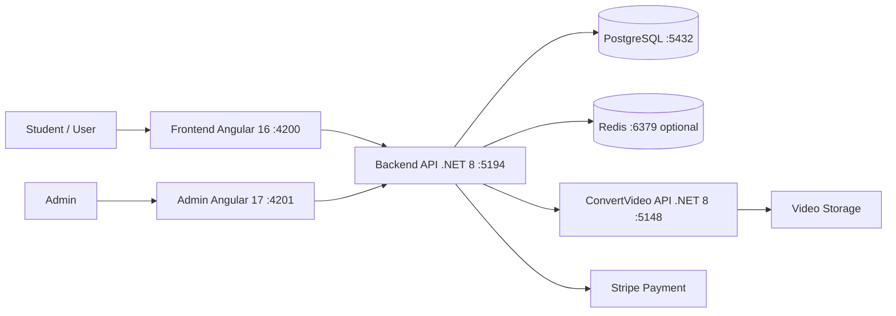

# HDNXUdemy - E-Learning Full-stack Platform

<p align="center">
  <strong>Nền tảng học trực tuyến full-stack phục vụ local demo đồ án</strong>
</p>

<p align="center">
  
  
  
  
</p>

---

## Giới thiệu

**HDNXUdemy** là nền tảng học trực tuyến theo mô hình Udemy Clone.

- Học viên có thể xem danh sách khóa học, đăng ký/mua khóa học và học video trực tuyến.
- Admin quản lý khóa học, danh mục, học viên, đơn mua, nội dung bài học, coupon và promotion.
- Hệ thống gồm Backend .NET 8, Frontend Angular 16, Admin Angular 17 và PostgreSQL.
- Dự án phù hợp chạy local để demo các luồng chính của một hệ thống E-Learning.

## Công nghệ sử dụng

| Layer | Technology |
|---|---|
| Backend API | .NET 8 Web API |
| ConvertVideo API | .NET 8 |
| Frontend | Angular 16 |
| Admin | Angular 17 |
| Database | PostgreSQL |
| Cache/Job optional | Redis |
| Payment | Stripe |
| Storage | Local video storage / cloud config |

## Kiến trúc hệ thống



## Cấu trúc thư mục

| Thư mục | Mô tả |
|---|---|
| `backend/` | Solution .NET 8 gồm API chính, service, data layer, model và ConvertVideo API |
| `frontend/` | Ứng dụng Angular 16 cho học viên |
| `admin/` | Ứng dụng Angular 17 cho trang quản trị |
| `backend/scripts/` | Script hỗ trợ seed/demo data |
| `LOCAL_SETUP.md` | Ghi chú setup local và checklist demo |

## Tính năng chính

### Học viên

- Xem, tìm kiếm và lọc khóa học theo danh mục.
- Xem chi tiết khóa học, nội dung bài học, giảng viên và đánh giá.
- Đăng ký/mua khóa học, thanh toán qua Stripe.
- Học video trực tuyến bằng HLS player.
- Quản lý tài khoản, khóa học đã mua, bookmark, Q&A và đánh giá.

### Admin

- Dashboard tổng quan doanh thu, học viên, khóa học và đơn mua.
- Quản lý khóa học, nội dung bài học, upload video và trạng thái hiển thị.
- Quản lý người dùng, danh mục, banner, tin tức, coupon và promotion.
- Quản lý đơn mua, thanh toán, cấu hình hệ thống và file upload.

### Backend

- REST API với Swagger/OpenAPI.
- Xác thực JWT và phân quyền theo vai trò.
- Entity Framework Core kết nối PostgreSQL.
- Xử lý thanh toán Stripe và webhook.
- Convert video MP4 sang HLS bằng FFmpeg.
- Hỗ trợ Redis, Hangfire, SignalR và cấu hình lưu trữ local/cloud.

## Yêu cầu hệ thống

| Công cụ | Phiên bản khuyến nghị |
|---|---|
| .NET SDK | 8.0+ |
| Node.js | 18 LTS |
| Angular CLI | 16.x cho Frontend, 17.x cho Admin |
| PostgreSQL | 15+ |
| Redis | 7.x, optional cho local demo |
| FFmpeg | 6.x+ cho xử lý video |

## Hướng dẫn chạy local

### 1. Clone repository

```bash
git clone https://github.com/<your-username>/UdemyClone.git
cd UdemyClone
```

### 2. Cấu hình môi trường

- Copy `.env.example` nếu cần và thay các giá trị `CHANGE_ME_*`.
- Cập nhật PostgreSQL connection string trong `backend/HDNXUdemyAPI/appsettings.Development.json`.
- Kiểm tra các cấu hình local path cho video/upload nếu chạy luồng upload hoặc convert video.
- Không commit secret thật như Stripe secret key, Cloudinary secret, AWS secret, SMTP credential hoặc OAuth client secret.

### 3. Chạy Backend API

```bash
cd backend
dotnet restore
dotnet run --project HDNXUdemyAPI
```

API chính chạy tại:

```text
http://localhost:5194
```

### 4. Chạy ConvertVideo API

```bash
cd backend
dotnet run --project HDNXUdemyConvertVideoAPI
```

ConvertVideo API chạy tại:

```text
http://localhost:5148
```

### 5. Chạy Frontend

```bash
cd frontend
npm install
npm start
```

Frontend chạy tại:

```text
http://127.0.0.1:4200
```

### 6. Chạy Admin

```bash
cd admin
npm install
npm start -- --host 127.0.0.1 --port 4201
```

Admin chạy tại:

```text
http://127.0.0.1:4201/
```

## URL local demo

| Ứng dụng | URL |
|---|---|
| Frontend | http://127.0.0.1:4200 |
| Admin | http://127.0.0.1:4201/ |
| Backend API | http://localhost:5194 |
| Backend Swagger | http://localhost:5194/swagger |
| ConvertVideo API | http://localhost:5148 |
| ConvertVideo Swagger | http://localhost:5148/swagger |
| PostgreSQL | localhost:5432 |
| Redis optional | localhost:6379 |

## Database local demo

Nếu có file backup PostgreSQL, restore vào database local sạch trước khi demo:

```bash
createdb -h localhost -p 5432 -U postgres HDNXUdemy
psql -h localhost -p 5432 -U postgres -d HDNXUdemy -f hdnx_udemy_backup_final_20260529.sql
```

Lưu ý:

- Không chạy lệnh reset hoặc restore lên database thật.
- Sau khi restore backup đã đúng schema, không cần chạy EF migration.
- Chỉ chạy migration khi tạo database mới từ migrations và đã kiểm tra schema.

## Tài khoản demo

| Role | Email | Password |
|---|---|---|
| Admin | `admin@themesbrand.com` | `123456` |
| Student | `student@hdnx.local` | `123456` |

Script tham khảo: `backend/scripts/seed-demo-data.ps1`.

## Ghi chú local demo

- Redis là optional cho các luồng cơ bản như xem khóa học, đăng nhập và CRUD chính.
- Với Angular dev server, nên mở trang root trước rồi điều hướng trong app để tránh lỗi deep link.
- JWT logout hiện chủ yếu xóa token phía client; token đã cấp vẫn hợp lệ đến khi hết hạn.
- Dependency audit có thể còn cảnh báo ở một số package frontend/toolchain; chấp nhận cho local demo, cần xử lý trước production.
- Không đóng gói `node_modules/`, `dist/`, `bin/`, `obj/`, `.vs/`, `.codex-run/`, `qa-artifacts/`, `logs/` hoặc `*.log`.

## Tài liệu chi tiết

| Tài liệu | Nội dung |
|---|---|
| [Backend README](./backend/README.md) | Kiến trúc API, cấu hình backend, entities và services |
| [Frontend README](./frontend/README.md) | Giao diện học viên, components, routing và services |
| [Admin README](./admin/README.md) | Dashboard quản trị, modules, state management và API integration |
| [LOCAL_SETUP.md](./LOCAL_SETUP.md) | Checklist setup local và các lưu ý khi demo |

## License

Dự án được phát triển cho mục đích học tập, nghiên cứu và demo đồ án.
