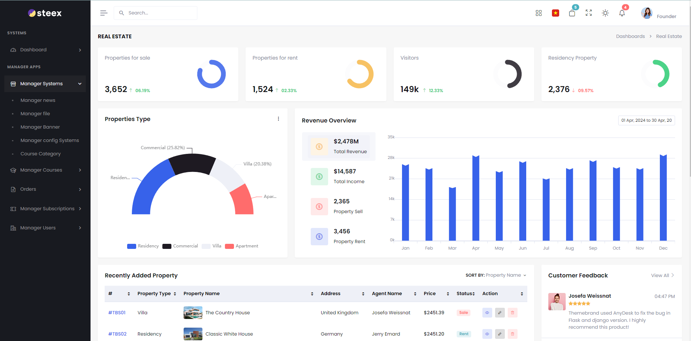
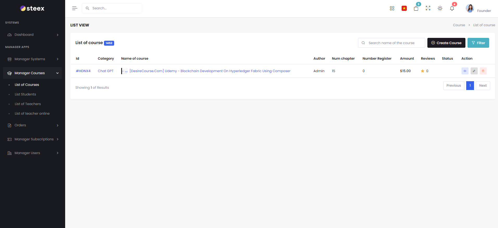

<![CDATA[# 📙 HDNXUdemy Admin — Dashboard Quản trị

<p align="center">
  
  
  
  
  
  
</p>

---

## 📖 Giới thiệu

Admin Dashboard là ứng dụng **Angular 17 SPA** được xây dựng dựa trên template **Steex**, dành cho **quản trị viên** quản lý toàn bộ hệ thống HDNXUdemy. Dashboard cung cấp giao diện quản trị chuyên nghiệp với: thống kê doanh thu, quản lý khóa học (tạo/sửa/xóa, thêm nội dung, upload video), quản lý người dùng, đơn hàng, danh mục, banner, tin tức, coupon, cấu hình hệ thống, và nhiều tính năng nâng cao khác.

- **Project name:** `steex` (Steex Angular Template)
- **Dev server:** http://127.0.0.1:4201/
- **Production URL:** https://hdnx-admin.devproinsights.com
- **Backend API:** http://localhost:5194/api/v1/
- **Video API:** http://localhost:5148/api/v1/

---

## 🏗️ Cấu trúc thư mục

```
admin/
├── src/
│   ├── app/
│   │   ├── account/                  # Auth pages (login, register)
│   │   ├── authlayout/               # Auth layout wrapper
│   │   ├── layouts/                  # Main layout system
│   │   │   ├── sidebar/              # Sidebar navigation
│   │   │   ├── topbar/               # Top navigation bar
│   │   │   ├── rightsidebar/          # Right sidebar (settings)
│   │   │   └── footer/               # Footer
│   │   │
│   │   ├── pages/                    # Feature modules
│   │   │   ├── dashboards/           # 📊 Dashboard
│   │   │   │   ├── index/            #    Dashboard chính
│   │   │   │   └── real-estate/      #    Dashboard bất động sản
│   │   │   │
│   │   │   ├── learning/             # 📖 Quản lý học tập
│   │   │   │   ├── courses/          #    Quản lý khóa học
│   │   │   │   │   ├── list-courses/ #       Danh sách khóa học
│   │   │   │   │   ├── create-course/ #      Tạo khóa học mới
│   │   │   │   │   ├── edit-course/  #       Sửa khóa học
│   │   │   │   │   ├── create-course-details/ # Thêm nội dung bài giảng
│   │   │   │   │   └── overview/     #       Tổng quan khóa học
│   │   │   │   ├── teacher/          #    Quản lý giảng viên
│   │   │   │   ├── student/          #    Quản lý học viên
│   │   │   │   └── learning-with-teacher/ # Đào tạo 1-1
│   │   │   │
│   │   │   ├── manager-system/       # ⚙️ Quản lý hệ thống
│   │   │   │   ├── category/         #    Danh mục
│   │   │   │   ├── products-grid/    #    Lưới sản phẩm
│   │   │   │   ├── product-details/  #    Chi tiết sản phẩm
│   │   │   │   ├── add-product/      #    Thêm sản phẩm
│   │   │   │   ├── orders/           #    Đơn hàng
│   │   │   │   ├── order-overview/   #    Chi tiết đơn hàng
│   │   │   │   ├── customers/        #    Khách hàng
│   │   │   │   ├── sellers/          #    Người bán
│   │   │   │   ├── seller-overview/  #    Chi tiết người bán
│   │   │   │   ├── cart/             #    Giỏ hàng
│   │   │   │   ├── checkout/         #    Thanh toán
│   │   │   │   ├── list-banner/      #    🏞️ Quản lý banner
│   │   │   │   ├── list-news/        #    📰 Quản lý tin tức
│   │   │   │   ├── list-file-upload/ #    📁 Quản lý file upload
│   │   │   │   └── list-system-config/ #  ⚙️ Cấu hình hệ thống
│   │   │   │
│   │   │   ├── purchase-order/       # 🧾 Quản lý đơn hàng
│   │   │   │   ├── list-purchase-order/ # Danh sách đơn hàng
│   │   │   │   └── purchase-review/  #    Review đơn hàng
│   │   │   │
│   │   │   ├── subscriptions/        # 🎟️ Quản lý gói & coupon
│   │   │   │   ├── overview/         #    Tổng quan
│   │   │   │   ├── list-subscriptions/ #  Danh sách gói
│   │   │   │   └── list-coupons/     #    Quản lý coupon
│   │   │   │
│   │   │   ├── user-manager/         # 👥 Quản lý người dùng
│   │   │   │   ├── list-user-manager/ #   Danh sách users
│   │   │   │   └── add-edit-account-user/ # Thêm/sửa user
│   │   │   │
│   │   │   ├── charts/               # 📈 Biểu đồ
│   │   │   ├── advanceui/            # 🎨 Advanced UI components
│   │   │   ├── custom-ui/            # 🎨 Custom UI components
│   │   │   └── extrapages/           # 📄 Extra pages (404, 500...)
│   │   │
│   │   ├── core/
│   │   │   ├── guards/               # Route guards (AuthGuard)
│   │   │   ├── helpers/              # HTTP interceptors
│   │   │   ├── services/             # 18 API services
│   │   │   ├── data/                 # Static/mock data
│   │   │   └── transfer-http/        # HTTP transfer service
│   │   │
│   │   ├── directives/              # Custom directives
│   │   ├── library/                 # Shared utilities
│   │   ├── models/                  # TypeScript models
│   │   │   ├── contants/            # Constants
│   │   │   ├── enum/                # Enumerations
│   │   │   ├── models/              # Data models
│   │   │   ├── request_model/       # Request DTOs
│   │   │   └── respone_model/       # Response DTOs
│   │   ├── pipeTransform/           # Custom pipes
│   │   ├── shared/                  # Shared components
│   │   ├── store/                   # NgRx State Management
│   │   │
│   │   ├── authUtils.ts             # Auth utility functions
│   │   ├── global-component.ts      # Global component registrations
│   │   ├── app.module.ts            # Root module
│   │   ├── app-routing.module.ts    # Root routes
│   │   └── app.component.ts         # Root component
│   │
│   ├── assets/
│   │   └── scss/
│   │       ├── bootstrap.scss       # Bootstrap customization
│   │       ├── app.scss             # Application styles
│   │       └── icons.scss           # Icon styles
│   ├── environments/
│   │   ├── environment.ts           # Development config
│   │   └── environment.prod.ts      # Production config
│   ├── styles.scss                  # Global styles
│   ├── index.html                   # HTML entry point
│   └── main.ts                      # Bootstrap entry
│
├── angular.json                     # Angular workspace config
├── package.json                     # Dependencies
├── tsconfig.json                    # TypeScript config
├── tsconfig.app.json                # App TS config
└── tsconfig.spec.json               # Test TS config
```

---

## 🗺️ Module Routing

### Root Routes (`app-routing.module.ts`)
```
/                → Auth Layout (Login/Register)
/pages/**        → Main Layout (Dashboard)
```

### Pages Routing (`pages-routing.module.ts`)

| Path | Module | Mô tả |
|---|---|---|
| `/pages/` | `DashboardsModule` | 📊 Dashboard tổng quan |
| `/pages/manager-system/**` | `ManagerSystemModule` | ⚙️ Quản lý hệ thống |
| `/pages/learning/**` | `LearningModule` | 📖 Quản lý học tập |
| `/pages/purchase-order/**` | `PurchaseOrderModule` | 🧾 Quản lý đơn hàng |
| `/pages/subscriptions/**` | `SubscriptionsModule` | 🎟️ Gói & Coupon |
| `/pages/user-manager/**` | `UserManagerModule` | 👥 Quản lý người dùng |
| `/pages/advance-ui/**` | `AdvanceuiModule` | 🎨 Advanced UI |
| `/pages/charts/**` | `ChartsModule` | 📈 Biểu đồ |
| `/pages/custom-ui/**` | `CustomUiModule` | 🎨 Custom UI |
| `/pages/pages/**` | `ExtrapagesModule` | 📄 Extra pages |

### Learning Module Routes
| Path | Component | Mô tả |
|---|---|---|
| `/pages/learning/courses` | List Courses | Danh sách khóa học |
| `/pages/learning/courses/create` | Create Course | Tạo khóa học mới |
| `/pages/learning/courses/edit/:id` | Edit Course | Sửa khóa học |
| `/pages/learning/courses/detail/:id` | Course Details | Thêm nội dung bài giảng |
| `/pages/learning/courses/overview/:id` | Overview | Tổng quan khóa học |
| `/pages/learning/teacher` | Teacher List | Quản lý giảng viên |
| `/pages/learning/student` | Student List | Quản lý học viên |

### Manager System Routes
| Path | Component | Mô tả |
|---|---|---|
| `/pages/manager-system/category` | Category | Quản lý danh mục |
| `/pages/manager-system/products` | Products Grid | Lưới sản phẩm |
| `/pages/manager-system/add-product` | Add Product | Thêm sản phẩm |
| `/pages/manager-system/orders` | Orders | Danh sách đơn hàng |
| `/pages/manager-system/customers` | Customers | Khách hàng |
| `/pages/manager-system/sellers` | Sellers | Người bán |
| `/pages/manager-system/banner` | Banner List | Quản lý banner |
| `/pages/manager-system/news` | News List | Quản lý tin tức |
| `/pages/manager-system/file-upload` | File Upload | Quản lý file |
| `/pages/manager-system/system-config` | System Config | Cấu hình hệ thống |

---

## 🔌 API Services (18 services)

| Service | File | Mô tả |
|---|---|---|
| `AuthService` | `auth.service.ts` | Xác thực, JWT, login/logout |
| `AuthFakeService` | `authfake.service.ts` | Mock auth cho development |
| `CourseService` | `course.service.ts` | CRUD khóa học, nội dung |
| `CategoryService` | `category.service.ts` | Danh mục & danh mục con |
| `BannerService` | `banner.service.ts` | Quản lý banner |
| `StudentService` | `student.service.ts` | Quản lý học viên |
| `PurchaseService` | `purchase.service.ts` | Đơn hàng & thanh toán |
| `StripeService` | `stripe.service.ts` | Stripe payment integration |
| `UserService` | `user.service.ts` | Quản lý người dùng |
| `MessengerService` | `messenger.service.ts` | Chat & messaging |
| `SystemConfigService` | `system-config.service.ts` | Cấu hình hệ thống |
| `UploadFileCloudService` | `upload-file-cloud.service.ts` | Upload file cloud |
| `UploadFileService` | `upload-file.service.ts` | Upload file server |
| `RestApiService` | `rest-api.service.ts` | Generic REST API wrapper |
| `CrudService` | `crud.service.ts` | Generic CRUD operations |
| `LanguageService` | `language.service.ts` | Đa ngôn ngữ (i18n) |
| `EventService` | `event.service.ts` | Event bus service |
| `TokenStorageService` | `token-storage.service.ts` | JWT token storage |

---

## 📊 State Management (NgRx)

Admin sử dụng **NgRx** cho state management:

```
src/app/store/
├── actions/        # Action creators
├── reducers/       # State reducers
├── effects/        # Side effects
└── selectors/      # State selectors
```

**Packages:**
- `@ngrx/store` — Store
- `@ngrx/effects` — Side effects
- `@ngrx/store-devtools` — DevTools integration

---

## 🎨 UI Libraries & Components

### Charts & Data Visualization
| Library | Mục đích |
|---|---|
| **ApexCharts** (`ng-apexcharts`) | Interactive charts (line, bar, pie, area) |
| **ECharts** (`ngx-echarts`) | Advanced charts & maps |
| **AMCharts 5** (`@amcharts/amcharts5`) | Geo maps & complex charts |

### UI Components
| Library | Mục đích |
|---|---|
| **Bootstrap 5.3** | CSS framework |
| **ngx-bootstrap** | Angular Bootstrap components |
| **ng-select** (`@ng-select/ng-select`) | Advanced select/dropdown |
| **ngx-toastr** | Toast notifications |
| **SweetAlert2** | Confirm/alert dialogs |
| **ngx-spinner** | Loading spinners |
| **ngx-ui-switch** | Toggle switches |
| **ngx-color-picker** | Color picker |
| **ngx-mask** | Input masking |
| **ngx-countup** | Number counter animation |
| **ng-otp-input** | OTP input component |
| **simplebar-angular** | Custom scrollbars |

### Rich Content
| Library | Mục đích |
|---|---|
| **CKEditor 5** (`@ckeditor/ckeditor5-angular`) | Rich text editor |
| **ngx-editor** | Alternative rich text editor |
| **PrismJS** | Syntax highlighting |
| **Flatpickr** (`angularx-flatpickr`) | Date picker |
| **FullCalendar** (`@fullcalendar/angular`) | Calendar component |

### Media & Layout
| Library | Mục đích |
|---|---|
| **ArtPlayer** | Video player (HLS) |
| **Slick Carousel** (`ngx-slick-carousel`) | Carousel slider |
| **Masonry** (`ngx-masonry`) | Masonry grid layout |
| **ngx-dropzone-wrapper** | Drag & drop file upload |
| **Lightbox** | Image lightbox |
| **Lordicon** (`@lordicon/element`) | Animated icons |
| **Lottie** (`lottie-web`) | Lottie animations |

### Maps
| Library | Mục đích |
|---|---|
| **Google Maps** (`@angular/google-maps`) | Google Maps integration |
| **Leaflet** (`@asymmetrik/ngx-leaflet`) | OpenStreetMap |

### Miscellaneous
| Library | Mục đích |
|---|---|
| **@ngx-translate** | i18n multi-language |
| **@ctrl/ngx-emoji-mart** | Emoji picker |
| **ngx-cookie-service** | Cookie management |
| **ngx-pipes** | Pipe utilities |
| **Firebase** (`@angular/fire`) | Firebase integration |
| **Moment.js** | Date manipulation |
| **UUID** | Unique ID generation |
| **Stripe.js** | Payment UI |

---

## 🔐 Authentication

### Auth Flow
```
Admin truy cập → Kiểm tra token (TokenStorageService)
    → Có token hợp lệ → Vào Dashboard
    → Không có / hết hạn → Redirect /login
        → Nhập credentials → AuthService.login()
        → POST /api/v1/authentication/login
        → Nhận JWT → Lưu TokenStorage → Vào Dashboard
```

### Auth Config
```typescript
export const environment = {
  production: false,
  baseUrl: 'http://localhost:5194/api/v1/',
  urlUploadFile: 'http://localhost:5148/api/v1/',
  defaultauth: 'backend',  // 'backend' | 'firebase'
  firebaseConfig: { ... },  // Firebase backup auth
  stripePublicKey: 'pk_test_...'
};
```

- **Primary auth:** Backend JWT (`defaultauth: 'backend'`)
- **Backup auth:** Firebase Authentication (optional)

---

## ⚙️ Environment Configuration

### Development (`environment.ts`)
| Key | Value | Mô tả |
|---|---|---|
| `production` | `false` | Chế độ development |
| `baseUrl` | `http://localhost:5194/api/v1/` | Main API |
| `urlUploadFile` | `http://localhost:5148/api/v1/` | Video API |
| `defaultauth` | `backend` | Auth provider |
| `stripePublicKey` | `pk_test_...` | Stripe key |

### Production (`environment.prod.ts`)
| Key | Value |
|---|---|
| `baseUrl` | `https://hdnxapi.devproinsights.com/api/v1/` |
| `urlUploadFile` | `https://hdnxvideo.devproinsights.com/api/v1/` |

---

## 🚀 Hướng dẫn chạy

### Prerequisites
- Bắt buộc Node 18 LTS, ví dụ `18.20.4`. Không dùng Node 24 cho rehearsal hiện tại vì `node-sass` có thể fail.
- Angular CLI 17+ (`npm install -g @angular/cli@17`)

### 1. Cài đặt

```bash
cd admin
npm install
```

> ⚠️ Nếu gặp lỗi peer dependency, file `.npmrc` đã cấu hình `legacy-peer-deps=true`.

### 2. Development Server

```bash
npm start -- --host 127.0.0.1 --port 4201
```

→ Truy cập http://127.0.0.1:4201/

> **Lưu ý:** Admin chạy trên port `4201` (khác với Frontend port `4200`) để tránh conflict. App không dùng hash routing, vì vậy không mở URL dạng hash. Mở root trước rồi đăng nhập/điều hướng trong app. Nếu mở trực tiếp `/auth/login` bị 404 từ dev server, cấu hình fallback về `index.html` hoặc mở root trước.

### 3. Build Production

```bash
ng build --configuration=production
# hoặc
npm run buildPro
```

→ Output: `dist/steex/`

### 4. Watch Mode

```bash
npm run watch
```

### 5. Unit Tests

```bash
ng test
# hoặc
npm test
```

---

## 📦 Dependencies chính

| Package | Version | Mục đích |
|---|---|---|
| `@angular/core` | ^17.0.4 | Angular framework |
| `@ngrx/store` | ^17.0.0 | State management |
| `@ngrx/effects` | ^17.0.0 | Side effects |
| `bootstrap` | 5.3.0 | CSS framework |
| `apexcharts` | ^3.44.0 | Charts |
| `echarts` | ^5.4.3 | Advanced charts |
| `@ckeditor/ckeditor5-angular` | ^7.0.1 | Rich text editor |
| `@fullcalendar/angular` | ^6.1.9 | Calendar |
| `artplayer` | ^5.1.1 | Video player |
| `hls.js` | ^1.5.1 | HLS streaming |
| `ngx-toastr` | ^18.0.0 | Notifications |
| `sweetalert2` | ^11.10.1 | Alert dialogs |
| `@stripe/stripe-js` | ^3.0.10 | Stripe payment |
| `@ngx-translate/core` | ^15.0.0 | i18n |
| `leaflet` | ^1.9.4 | Maps |
| `firebase` | ^10.6.0 | Firebase SDK |
| `ngx-spinner` | ^16.0.2 | Loading spinner |
| `@ng-select/ng-select` | ^12.0.4 | Select dropdown |

---

## 📸 Screenshots






---

## 📄 Tham khảo thêm

- [📘 Main README](../README.md) — Tổng quan dự án
- [⚙️ Backend README](../backend/README.md) — API documentation
- [📗 Frontend README](../frontend/README.md) — Giao diện học viên

---

<p align="center">
  Made with ❤️ by <strong>HDNX Team</strong>
</p>
]]>
