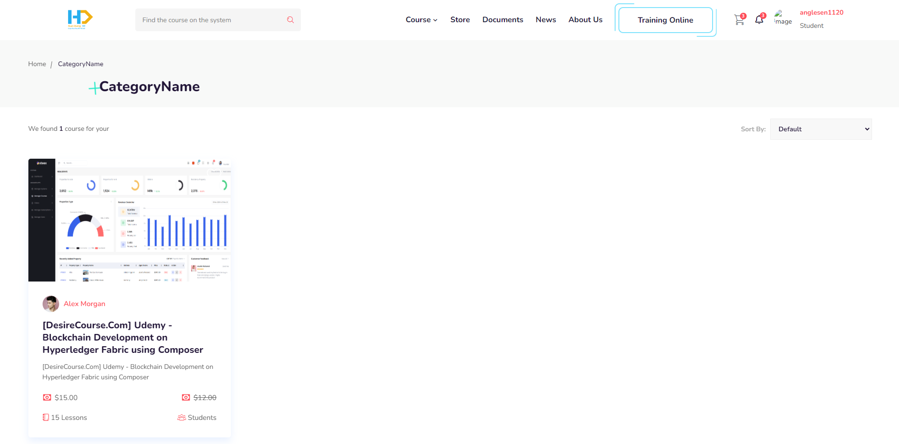
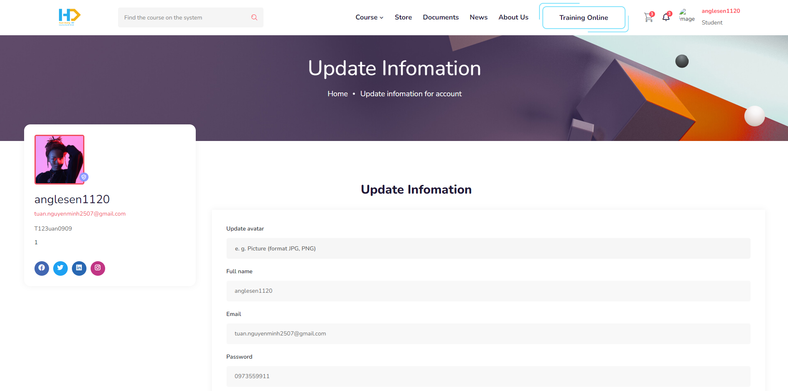

<![CDATA[# 📗 HDNXUdemy Frontend — Giao diện Học viên

<p align="center">
  
  
  
  
  
  
</p>

---

## 📖 Giới thiệu

Frontend là ứng dụng **Angular 16 SPA** (Single Page Application) dành cho **học viên** của nền tảng HDNXUdemy. Giao diện được thiết kế theo phong cách e-learning hiện đại, hỗ trợ đầy đủ các chức năng: duyệt khóa học, xem video streaming HLS, mua khóa học qua Stripe, quản lý tài khoản, bookmark, đánh giá, Q&A real-time, và nhiều hơn nữa.

- **Project name:** `hdnx-udemy-ng` (package.json) / `odemy-ng` (angular.json)
- **Dev server:** http://localhost:4200
- **Production URL:** https://web-hdnx.devproinsights.com
- **Backend API:** http://localhost:5194/api/v1/
- **Video API:** http://localhost:5148/api/v1/

---

## 🏗️ Cấu trúc thư mục

```
frontend/
├── src/
│   ├── app/
│   │   ├── components/
│   │   │   ├── common/           # Shared/reusable components
│   │   │   │   ├── navbar/           # Header navigation
│   │   │   │   ├── footer/           # Footer
│   │   │   │   ├── courses/          # Course card grid
│   │   │   │   ├── instructor/       # Instructor showcase
│   │   │   │   ├── partner/          # Partner logos carousel
│   │   │   │   ├── premium-access/   # CTA banner
│   │   │   │   ├── subscribe/        # Newsletter subscribe
│   │   │   │   ├── training/         # Training section
│   │   │   │   ├── features/         # Features showcase
│   │   │   │   ├── funfacts-feedback/ # Statistics counters
│   │   │   │   ├── video/            # Video player wrapper
│   │   │   │   ├── video-style-two/  # Alternative video layout
│   │   │   │   ├── apply-instructor/ # Apply to teach CTA
│   │   │   │   ├── teacher-register/ # Teacher registration form
│   │   │   │   └── hdnx-loading/     # Loading spinner
│   │   │   │
│   │   │   ├── dialog/              # Modal dialogs
│   │   │   │   ├── user-comment-courses/    # Q&A comment modal
│   │   │   │   └── user-review-courses/     # Review/rating modal
│   │   │   │
│   │   │   └── pages/               # Page components (37 pages)
│   │   │       ├── elearning-school/      # 🏠 Trang chủ
│   │   │       │   ├── elearning-banner/  #    Hero banner
│   │   │       │   └── elearning-about/   #    About section
│   │   │       ├── courses-list/          # 📚 Danh sách khóa học
│   │   │       ├── courses-details/       # 📖 Chi tiết khóa học
│   │   │       ├── courses-content-detail/ # ▶️ Xem nội dung bài giảng
│   │   │       ├── training-courses-list/  # 🎓 Khóa đào tạo trực tuyến
│   │   │       ├── training-courses-details/ # 📋 Chi tiết khóa đào tạo
│   │   │       ├── cart/                  # 🛒 Giỏ hàng
│   │   │       ├── checkout/              # 💳 Thanh toán (Stripe)
│   │   │       ├── payment-success/       # ✅ Thanh toán thành công
│   │   │       ├── payment-error/         # ❌ Thanh toán thất bại
│   │   │       ├── login-pages/           # 🔐 Đăng nhập
│   │   │       ├── register-pages/        # 📝 Đăng ký
│   │   │       ├── register-error/        # ⚠️ Lỗi đăng ký
│   │   │       ├── send-email-after-register/ # 📩 Xác minh email
│   │   │       ├── account-profile-courses/ # 📚 Khóa học đã mua
│   │   │       ├── account-profile-details/ # 👤 Thông tin cá nhân
│   │   │       ├── account-bookmark-course/ # 🔖 Bookmark khóa học
│   │   │       ├── notification-users/    # 🔔 Thông báo
│   │   │       ├── categories/            # 📂 Danh mục
│   │   │       ├── teacher/               # 👨‍🏫 Danh sách giảng viên
│   │   │       ├── profile-teacher/       # 👨‍🏫 Profile giảng viên
│   │   │       ├── become-a-teacher/      # 🎯 Đăng ký làm giảng viên
│   │   │       ├── courses-news/          # 📰 Tin tức
│   │   │       ├── courses-details-news/  # 📰 Chi tiết tin tức
│   │   │       ├── products-list/         # 🛍️ Sản phẩm
│   │   │       ├── products-details/      # 🛍️ Chi tiết sản phẩm
│   │   │       ├── down-load-recourses/   # 📥 Tải tài liệu
│   │   │       ├── membership-levels/     # 👑 Gói thành viên
│   │   │       ├── about/                 # ℹ️ Giới thiệu
│   │   │       ├── contact-us/            # 📞 Liên hệ
│   │   │       ├── faq/                   # ❓ FAQ
│   │   │       ├── gallery/               # 🖼️ Thư viện ảnh
│   │   │       ├── purchase-guide/        # 📋 Hướng dẫn mua
│   │   │       ├── privacy-policy/        # 🔒 Chính sách bảo mật
│   │   │       ├── terms-of-service/      # 📄 Điều khoản sử dụng
│   │   │       ├── coming-soon/           # 🚧 Coming Soon
│   │   │       └── my-courses-list/       # 📚 Danh sách khóa học (shared)
│   │   │
│   │   ├── core/
│   │   │   ├── guards/               # Route guards (AuthGuard)
│   │   │   ├── helpers/              # HTTP interceptors, helpers
│   │   │   ├── services/             # API services (15 services)
│   │   │   └── transfer-http/        # HTTP transfer service
│   │   │
│   │   ├── directives/              # Custom directives
│   │   │   └── fallback-src.directive.ts  # Fallback image directive
│   │   │
│   │   ├── library/                 # Shared utilities
│   │   │   └── custompipe/
│   │   │       └── asset-url.pipe.ts  # Asset URL pipe
│   │   │
│   │   ├── models/                  # TypeScript models
│   │   │   ├── contants/            # Constants
│   │   │   ├── enum/                # Enumerations
│   │   │   ├── models/              # Data models
│   │   │   └── respone_model/       # API response models
│   │   │
│   │   ├── pipeTransform/           # Custom pipes
│   │   ├── app.module.ts            # Root module
│   │   ├── app-routing.module.ts    # Route definitions
│   │   └── app.component.ts         # Root component
│   │
│   ├── assets/                      # Static assets (images, CSS)
│   │   └── css/
│   │       └── flaticon.css          # Flaticon icon set
│   ├── environments/
│   │   ├── environment.ts           # Development config
│   │   └── environment.prod.ts      # Production config
│   ├── styles.scss                  # Global styles (~190KB)
│   ├── index.html                   # HTML entry point
│   └── main.ts                      # Bootstrap entry
│
├── angular.json                     # Angular workspace config
├── package.json                     # Dependencies
├── tsconfig.json                    # TypeScript config
├── tsconfig.app.json                # App-specific TS config
├── tsconfig.spec.json               # Test TS config
├── tslint.json                      # Linting rules
└── karma.conf.js                    # Karma test config
```

---

## 🗺️ Routing (37 routes)

| Path | Component | Guard | Mô tả |
|---|---|---|---|
| `/` | `ElearningSchoolComponent` | — | Trang chủ |
| `/about` | `AboutComponent` | — | Giới thiệu |
| `/teacher` | `TeacherComponent` | — | Danh sách giảng viên |
| `/infomation-teacher` | `ProfileTeacherComponent` | — | Profile giảng viên |
| `/faq` | `FaqComponent` | — | Câu hỏi thường gặp |
| `/coming-soon` | `ComingSoonComponent` | — | Coming Soon |
| `/purchase-guide` | `PurchaseGuideComponent` | — | Hướng dẫn mua |
| `/privacy-policy` | `PrivacyPolicyComponent` | — | Chính sách bảo mật |
| `/terms-of-service` | `TermsOfServiceComponent` | — | Điều khoản sử dụng |
| `/courses/:id` | `CoursesListComponent` | — | Khóa học theo danh mục |
| `/detail-courses/:id` | `CoursesDetailsComponent` | — | Chi tiết khóa học |
| `/detail-content-course/:id` | `CoursesContentDetailComponent` | — | Xem nội dung bài giảng |
| `/membership-levels` | `MembershipLevelsComponent` | — | Gói thành viên |
| `/become-teacher` | `BecomeATeacherComponent` | — | Đăng ký giảng viên |
| `/categories` | `CategoriesComponent` | — | Danh mục |
| `/download-document` | `DownLoadRecoursesComponent` | — | Tải tài liệu |
| `/products` | `ProductsListComponent` | — | Sản phẩm |
| `/cart` | `CartComponent` | — | Giỏ hàng |
| `/payment/:purchaseCode` | `CheckoutComponent` | 🔒 `AuthGuard` | Thanh toán |
| `/details-products` | `ProductsDetailsComponent` | — | Chi tiết sản phẩm |
| `/gallery` | `GalleryComponent` | — | Thư viện ảnh |
| `/news` | `CoursesNewsComponent` | — | Tin tức |
| `/detail-news` | `BlogDetailsStyleTwoComponent` | — | Chi tiết tin tức |
| `/contact` | `ContactUsComponent` | — | Liên hệ |
| `/login` | `LoginPagesComponent` | — | Đăng nhập |
| `/register` | `RegisterPagesComponent` | — | Đăng ký |
| `/my-course` | `AccountProfileCoursesComponent` | 🔒 `AuthGuard` | Khóa học đã mua |
| `/my-information` | `AccountProfileDetailsComponent` | 🔒 `AuthGuard` | Thông tin cá nhân |
| `/training-online` | `TrainingCoursesComponent` | — | Khóa đào tạo |
| `/detail-training-online` | `TrainingCoursesDetailsComponent` | — | Chi tiết đào tạo |
| `/register-error` | `RegisterErrorComponent` | — | Lỗi đăng ký |
| `/send-email-register-success` | `SendEmailAfterRegisterComponent` | — | Xác minh email |
| `/notification` | `NotificationUsersComponent` | 🔒 `AuthGuard` | Thông báo |
| `/bookmark-course` | `AccountBookmarkCourseComponent` | 🔒 `AuthGuard` | Bookmark |
| `/payment-success` | `PaymentSuccessComponent` | — | Thanh toán thành công |
| `/payment-error` | `PaymentErrorComponent` | — | Thanh toán thất bại |

> 🔒 = Yêu cầu đăng nhập (AuthGuard)

---

## 🔌 API Services (15 services)

| Service | File | Mô tả |
|---|---|---|
| `AuthenticationService` | `authentication.service.ts` | Đăng nhập, đăng ký, OAuth (Google/Facebook) |
| `CourseService` | `course.service.ts` | CRUD khóa học, nội dung, đánh giá |
| `StudentService` | `student.service.ts` | Tiến độ học, thông tin cá nhân |
| `CategoryService` | `category.service.ts` | Danh mục & danh mục con |
| `BannerService` | `banner.service.ts` | Banner trang chủ |
| `CartService` | `cart.service.ts` | Giỏ hàng |
| `PurchaseService` | `purchase.service.ts` | Đơn hàng & lịch sử mua |
| `StripeService` | `stripe.service.ts` | Thanh toán Stripe |
| `HomeService` | `home.service.ts` | Dữ liệu trang chủ |
| `MessengerService` | `messenger.service.ts` | Q&A, chat, @mention |
| `HubNotificationService` | `hub-notification.service.ts` | SignalR real-time |
| `SystemConfigService` | `system-config.service.ts` | Cấu hình hệ thống |
| `UploadFileCloudService` | `upload-file-cloud.service.ts` | Upload file cloud |
| `UploadFileService` | `upload-file.service.ts` | Upload file server |
| `TransferHttp` | `transfer-http.ts` | HTTP wrapper |

---

## 🎨 UI Libraries & Styling

| Library | Mục đích |
|---|---|
| **Bootstrap 5.3** | CSS framework chính |
| **ngx-owl-carousel-o** | Carousel slider (khóa học, banner) |
| **ngx-lightbox** | Lightbox gallery |
| **lightgallery** | Advanced gallery |
| **animate.css** | CSS animations |
| **boxicons** | Icon set |
| **Flaticon** | Custom icon set |
| **ngx-stars** | Star rating component |
| **ngx-scrolltop** | Scroll to top button |
| **ngx-simple-countdown** | Countdown timer |
| **ngx-countup** | Number counter animation |
| **ng-bootstrap** | Angular Bootstrap components (Modal, Accordion, Tooltip) |
| **ngx-bootstrap** | Pagination, Dropdown |
| **SweetAlert2** | Beautiful alert/confirm dialogs |
| **angular-mentions** | @mention in Q&A comments |
| **ArtPlayer** | Video player (HLS streaming) |
| **artplayer-plugin-hls-quality** | HLS quality selector |
| **@ng-icons/bootstrap-icons** | Bootstrap icon components |

---

## 🔐 Authentication Flow

### Email Login
```
User nhập email/password → AuthenticationService.login()
    → POST /api/v1/authentication/login
    → Nhận JWT token → Lưu vào localStorage
    → AuthGuard kiểm tra token cho protected routes
```

### Social Login (Google / Facebook)
```
User click Google/Facebook button
    → @abacritt/angularx-social-login xử lý OAuth
    → Nhận social token → Gửi lên backend
    → Backend validate & tạo JWT
    → Frontend nhận JWT → Lưu vào localStorage
```

**Social Auth Config:**
- **Google:** `458553878162-...apps.googleusercontent.com`
- **Facebook:** App ID `727016849494944`

---

## 🎬 Video Player (ArtPlayer + HLS)

```typescript
// Sử dụng ArtPlayer với HLS streaming
// - Hỗ trợ adaptive bitrate (quality selector plugin)
// - Xem video dạng .m3u8 (HTTP Live Streaming)
// - Fallback MP4 cho trình duyệt không hỗ trợ HLS
//
// API endpoints:
// - HLS: GET /api/v1/get-video-stream/stream/{filename}
// - MP4: GET /api/v1/get-video-stream/stream/mp4/{filename}
```

---

## ⚙️ Environment Configuration

### Development (`environment.ts`)
```typescript
export const environment = {
  production: false,
  baseUrl: 'http://localhost:5194/api/v1/',
  urlUploadFile: 'http://localhost:5148/api/v1/',
  clientIdGoogle: '458553878162-...apps.googleusercontent.com',
  facebookId: '727016849494944',
  baseUrlHub: 'http://localhost:5194/',
  stripePublicKey: 'pk_test_...'
};
```

### Production (`environment.prod.ts`)
- `baseUrl` → `https://hdnxapi.devproinsights.com/api/v1/`
- `urlUploadFile` → `https://hdnxvideo.devproinsights.com/api/v1/`
- `baseUrlHub` → `https://hdnxapi.devproinsights.com/`

---

## 🚀 Hướng dẫn chạy

### Prerequisites
- Bắt buộc Node 18 LTS, ví dụ `18.20.4`. Không dùng Node 24 cho rehearsal hiện tại vì `node-sass` có thể fail.
- Angular CLI 16+ (`npm install -g @angular/cli@16`)

### 1. Cài đặt

```bash
cd frontend
npm install
```

### 2. Development Server

```bash
ng serve
# hoặc
npm start
```

→ Truy cập http://localhost:4200

### 3. Build Production

```bash
ng build --configuration=production
# hoặc
npm run buildPro
```

→ Output: `dist/odemy-ng/`

### 4. Lint

```bash
npm run lint
```

### 5. Unit Tests

```bash
ng test
# hoặc
npm test
```

---

## 📦 Dependencies chính

| Package | Version | Mục đích |
|---|---|---|
| `@angular/core` | ^16.0.1 | Angular framework |
| `bootstrap` | ^5.3.2 | CSS framework |
| `rxjs` | ^7.5.2 | Reactive programming |
| `@stripe/stripe-js` | ^3.0.10 | Stripe payment |
| `@microsoft/signalr` | ^8.0.0 | Real-time (SignalR) |
| `artplayer` | ^5.1.1 | Video player |
| `@mux/mux-player` | ^1.11.4 | Mux video player |
| `sweetalert2` | ^11.10.3 | Alert dialogs |
| `ngx-owl-carousel-o` | ^16.0.0 | Carousel |
| `lightgallery` | ^2.7.0 | Gallery viewer |
| `ngx-stars` | ^1.6.5 | Star rating |
| `ngx-bootstrap` | ^11.0.2 | Bootstrap components |
| `@ng-bootstrap/ng-bootstrap` | ^15.1.2 | Angular Bootstrap |
| `angular-mentions` | ^1.5.0 | @mention support |
| `@abacritt/angularx-social-login` | ^2.1.0 | Google/Facebook OAuth |

---

## 📸 Screenshots







---

## 📄 Tham khảo thêm

- [📘 Main README](../README.md) — Tổng quan dự án
- [⚙️ Backend README](../backend/README.md) — API documentation
- [📙 Admin README](../admin/README.md) — Dashboard quản trị

---

<p align="center">
  Made with ❤️ by <strong>HDNX Team</strong>
</p>
]]>
